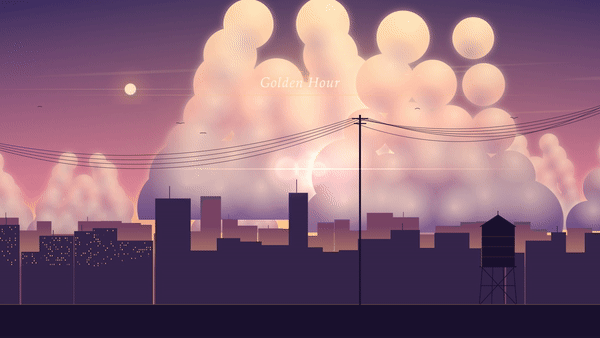
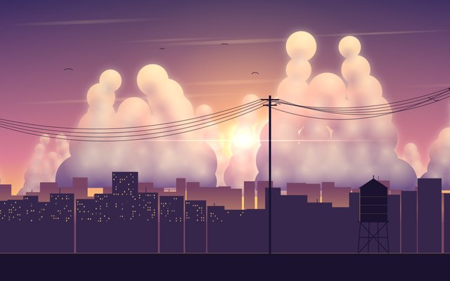
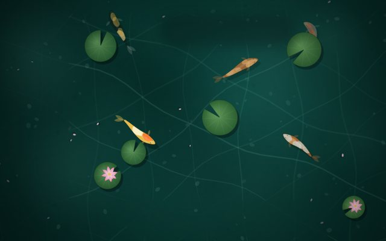
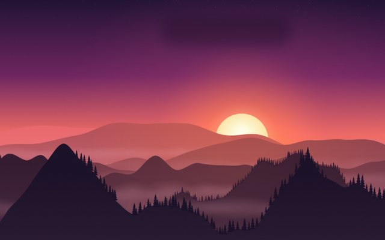
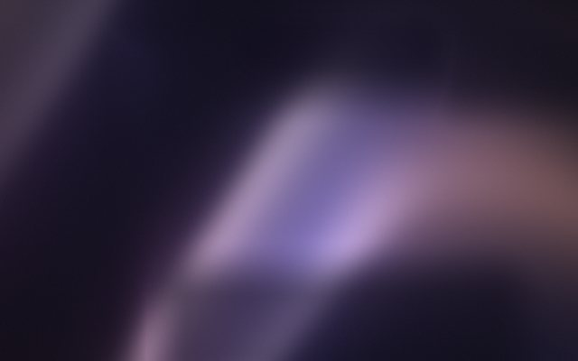
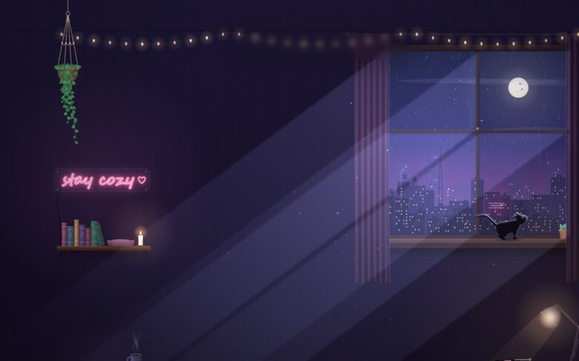

# T3 Code Themes

Ten animated themes for [T3 Code](https://github.com/pingdotgg/t3code), drawn entirely in code. By Zirko Mirko Labs.



**[▶ Try them live in your browser](https://zirkomirkolabs.github.io/t3code-themes/)** · [Watch the 23-second video](media/t3code-themes-launch.mp4)

**New: the app.** Use the themes inside T3 Code with a Themes button, a library and an 11th theme, **Cozy Room**, which has a cat living in it. **[▶ Try the app in your browser](https://zirkomirkolabs.github.io/t3code-themes/app/preview/)** · [Watch the 50-second video](media/themes-proposal.mp4) · [Install it](app/README.md)

Each theme sets the colours, fonts and panel style, draws a live animated background and plays a short title animation. There are no image or video files and no network requests: every lantern, koi and wave is drawn on a canvas by a few hundred lines of JavaScript.

## The themes

| | | |
|---|---|---|
| <br>**Golden Hour** · the city exhales before the lights come on | <br>**Koi Pond** · click the water to make ripples | <br>**Lantern Night** · make a wish and let it rise |
| <br>**Great Wave** · a woodblock sea (light) | <br>**Cozy Cabin** · warm windows, quiet snow | <br>**Ridgeline** · last light over the far ridges |
| <br>**Summer Meadow** · the wind knows the way home (light) | <br>**Aero** · glossy bubbles, blue sky (light) | <br>**Blue Tide** · the sea is glowing tonight |
| <br>**Silk** · folds of light, slowly breathing | | |

## Use them today

### In your browser

Open the [live player](https://zirkomirkolabs.github.io/t3code-themes/). Pick a theme from the bar at the bottom, then press **Full screen**. The bar hides itself when you stop moving the mouse.

Add these to the link:

| Add | What it does |
|---|---|
| `?theme=koi-pond` | opens that theme (ids are the folder names in `themes/`) |
| `&wallpaper` | hides every control and the title, for a clean background |
| `&title=1` | shows the title animation in wallpaper mode |
| `&cycle=60` | switches to the next theme every 60 seconds |

### As a live desktop wallpaper

Any app that can show a web page as a wallpaper works. Use the wallpaper link, for example:

```
https://zirkomirkolabs.github.io/t3code-themes/?theme=cozy-cabin&wallpaper
```

- **Windows:** [Lively Wallpaper](https://www.rocksdanister.com/lively/) (free): **+ Add wallpaper**, paste the link. Wallpaper Engine also takes a web page.
- **macOS:** [Plash](https://sindresorhus.com/plash) (free): add the link as a website.
- **Linux (KDE):** use a web-page wallpaper plugin with the same link.

Wallpaper apps usually pause the animation when a window is full screen, so it costs nothing while you work.

### Inside T3 Code: the app

T3 Code has no theme support yet, so [`app/`](app/README.md) adds it. It opens the real T3 Code client in its own window, without changing the official app, and adds a **Themes** button at the bottom right: a library to search, preview live and apply themes; Live / Calm / Still motion; one-file sharing; and **Create**, which writes a new theme from a description.

[](https://zirkomirkolabs.github.io/t3code-themes/app/preview/)

**Cozy Room** (the app's default) is a rainy night room with a black cat who lives on your desk. It walks behind the composer, paws the Send button, naps on its cushion and wakes up when you type. Install: get Node.js LTS, keep T3 Code running and double-click `app/START.cmd` (macOS/Linux: `app/start.sh`). See [app/README.md](app/README.md).

The themes use a small, documented format (`t3theme/1`), so they can drop straight into T3 Code if it adds a theme hook.

## What is in a theme

```
themes/<id>/
  theme.json   colours, fonts, shape, panel style and scene settings (format "t3theme/1")
  scene.js     the animated background, drawn on a canvas
  welcome.js   the title animation
  thumb.jpg    640x400 preview
```

`player/sandbox.js` runs a theme in the player. `app/` is the T3 Code add-on (launcher, runtime, theme studio and a browser playground). `index.html` is the player page, and `tools/record-clips.py` records smooth MP4 clips of any theme.

## Safety

Theme code is treated as untrusted. `sandbox.js` runs `scene.js` and `welcome.js` in a Web Worker inside a sandboxed iframe with an opaque origin and a Content Security Policy that blocks all network access. A theme cannot read the page, cookies, chats or keys. A scene that hangs is stopped, and a scene that is too heavy is drawn at a lower resolution, then frozen. The animation pauses when the tab is hidden or the system asks for reduced motion.

## Run it locally

```
git clone https://github.com/ZirkoMirkoLabs/t3code-themes
cd t3code-themes
python -m http.server 8791
```

Then open http://127.0.0.1:8791/. Any static file server works.

## License

MIT. See [LICENSE](LICENSE).
