# T3 Code Themes

A Themes add-on for [T3 Code](https://github.com/pingdotgg/t3code), with 25 animated themes, and you can make your own from a description using your own Claude or Codex subscription. By Zirko Mirko Labs. Unofficial: not made by or affiliated with the T3 Code team.

[](media/themes-proposal.mp4)

**[▶ Watch the new 17-second video](media/make-any-theme.mp4)** · [the 50-second video](media/themes-proposal.mp4) · [Install the app](app/README.md) · [Play the themes in your browser](https://zirkomirkolabs.github.io/t3code-themes/)

The app opens the real T3 Code client in its own window and adds a **Themes** button at the bottom right. Pick a theme and the whole app changes: colours, fonts, panels, an animated background and a title animation. The official app is not modified.

**Cozy Room** is the default: a rainy night room with a black cat who lives on your desk. It walks behind the composer, paws the Send button, naps on its cushion and wakes up when you type.

## The Viral themes (new)

Eight code-only themes where the whole background reacts to your cursor. They are examples: make your own with **Create** in the app.

| | | | |
|---|---|---|---|
| 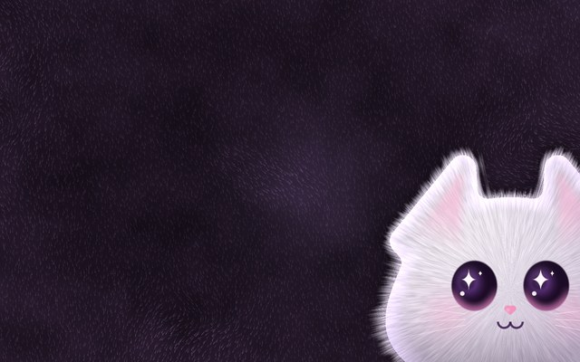<br>**Purrfect Plush** · pat the cat, get hearts | 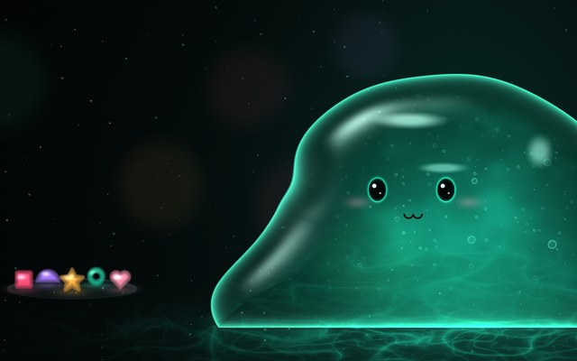<br>**Jelly Friend** · poke it, it wobbles | 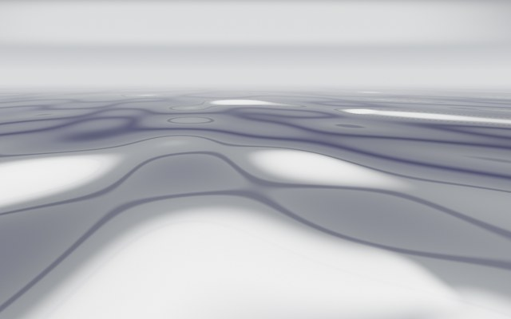<br>**Liquid Chrome** · click for a splash | 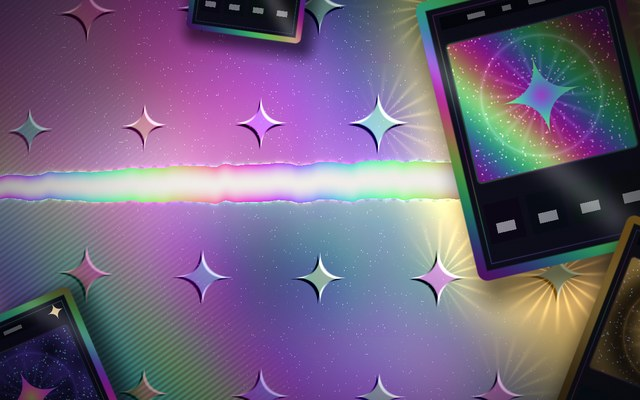<br>**Holo Foil** · tilt the foil, tear it open |
| 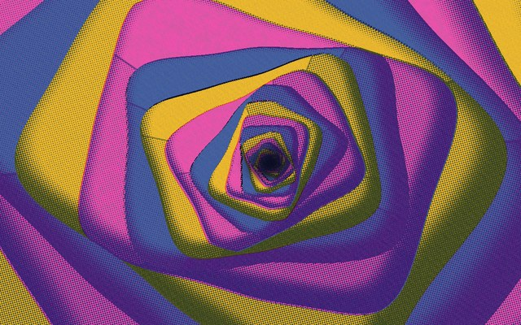<br>**Riso Fold** · an endless paper tunnel | 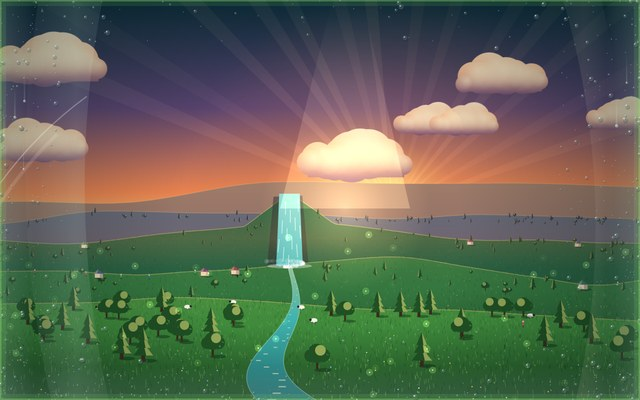<br>**Pocket Eden** · plant trees, make rain | 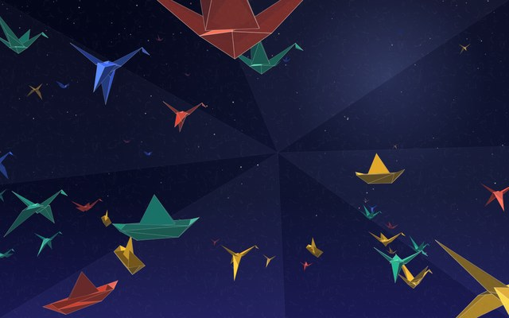<br>**Midnight Fold** · click to fold a crane | 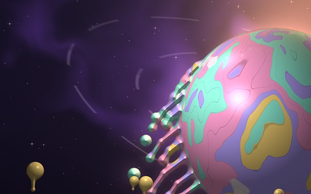<br>**Sugar Meltdown** · fling a moon |

Try them in the [live player](https://zirkomirkolabs.github.io/t3code-themes/?theme=viral-fur-cat).

## The themes

| | | |
|---|---|---|
| <br>**Cozy Room** · a lofi night room, and a cat who supervises | 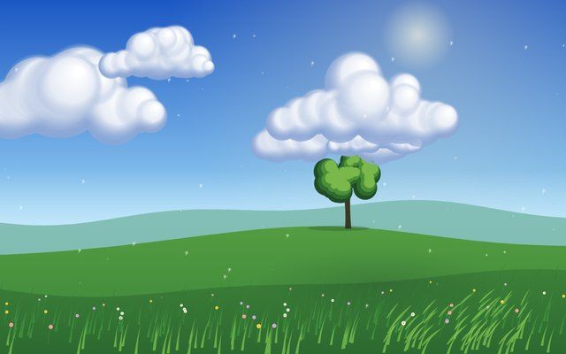<br>**Summer Meadow** · the wind knows the way home (light) | 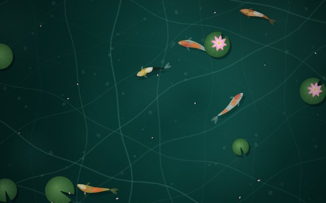<br>**Koi Pond** · click the water to make ripples |
| 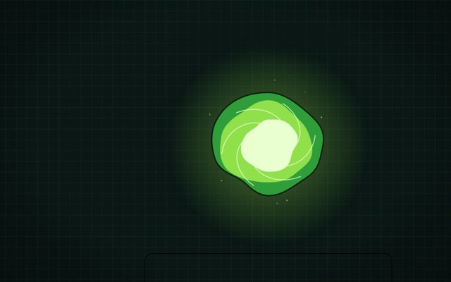<br>**Portal Lab** · interdimensional by default | 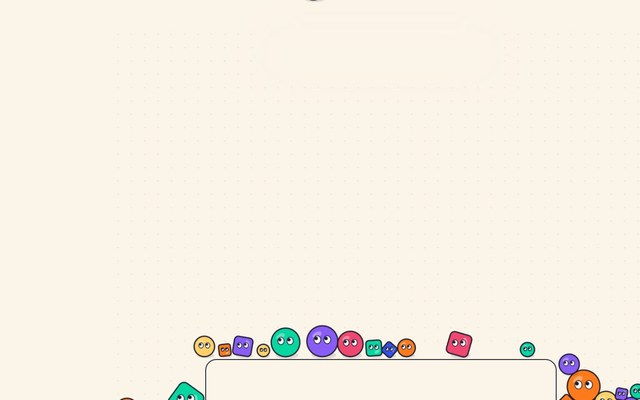<br>**Playground** · grab, throw, repeat (light) | 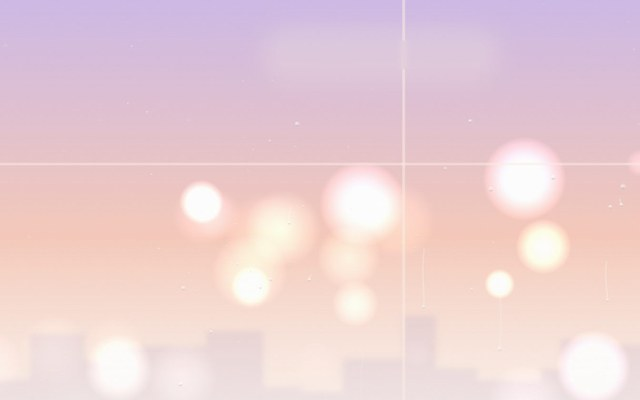<br>**Rainy Café** · a quiet corner table (light) |
| 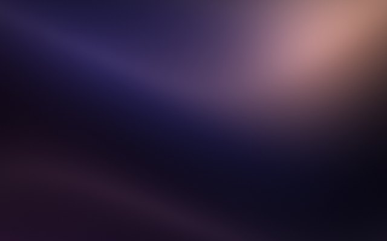<br>**Silk** · folds of light, slowly breathing | <br>**Moss Garden** · morning mist in a Kyoto garden (light) | <br>**Hanami** · blossoms against a spring sky (light) |
| 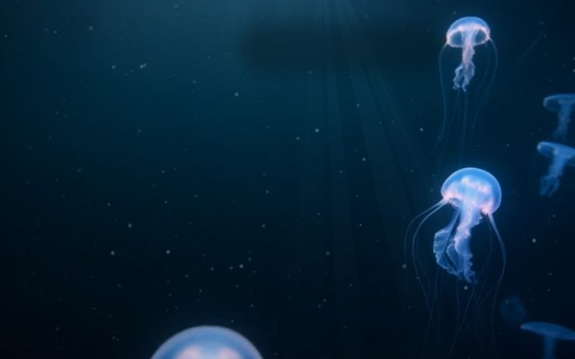<br>**Midnight Zone** · bioluminescence far below | 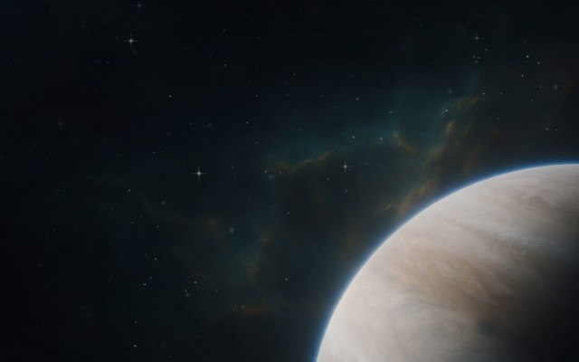<br>**Deep Field** · a gas giant at the edge of the frame | <br>**Glacier** · first snow on a frozen lake (light) |
| <br>**Lamplight** · one more chapter before bed | <br>**Dune** · wind over an apricot morning (light) | 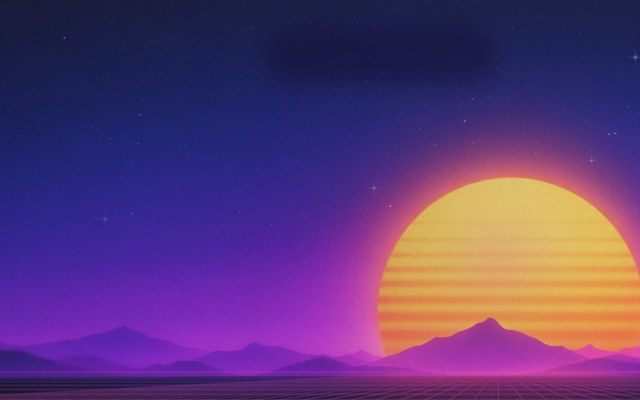<br>**Outrun** · a striped sun on an endless grid |
| 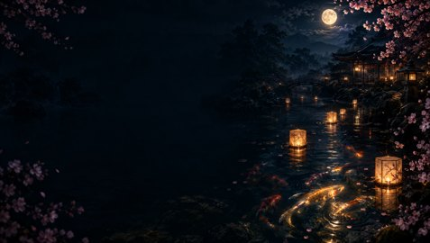<br>**Koi Lantern Night** · lanterns and koi under the moon | 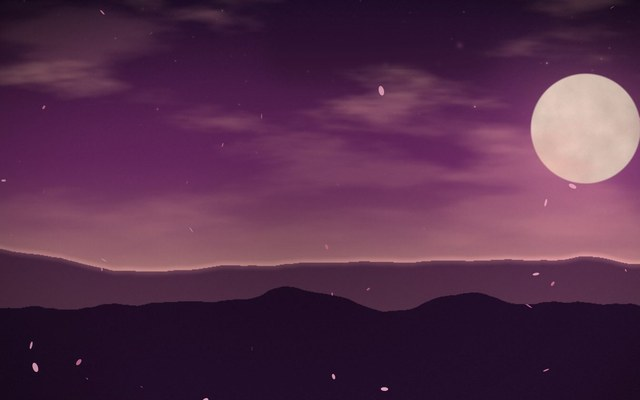<br>**Sakura Dusk** · petals at golden hour | |

The first seven in this table are drawn entirely in code, with no image or video files. Moss Garden to Outrun use a painted backdrop (some with a short video loop), with code effects on top: mist, falling petals, snow, light rays and ripples. Koi Lantern Night and Sakura Dusk are picture-and-particle skins.

## Install the app

1. Install **T3 Code** and **Node.js LTS** (https://nodejs.org).
2. Open T3 Code and keep it running.
3. Double-click **`app/START.cmd`** (macOS/Linux: run `app/start.sh`). The first launch downloads Electron and ffmpeg, about 200 MB.

The launcher finds T3 Code by itself. Click **Themes** at the bottom right to browse, preview and apply themes, or **Create** to make a new one from a description. See [app/README.md](app/README.md) for everything else: sharing, motion settings and the theme format.

## In your browser

The [live player](https://zirkomirkolabs.github.io/t3code-themes/) plays the 15 code-only themes full screen, including Cozy Room with its cat. Add these to the link:

| Add | What it does |
|---|---|
| `?theme=koi-pond` | opens that theme (ids are the folder names in `themes/`) |
| `&wallpaper` | hides every control and the title, for a clean background |
| `&title=1` | shows the title animation in wallpaper mode |
| `&cycle=60` | switches to the next theme every 60 seconds |

### As a live desktop wallpaper

Any app that can show a web page as a wallpaper works, for example:

```
https://zirkomirkolabs.github.io/t3code-themes/?theme=cozy-room&wallpaper
```

- **Windows:** [Lively Wallpaper](https://www.rocksdanister.com/lively/) (free): **+ Add wallpaper**, paste the link. Wallpaper Engine also takes a web page.
- **macOS:** [Plash](https://sindresorhus.com/plash) (free): add the link as a website.
- **Linux (KDE):** use a web-page wallpaper plugin with the same link.

## What is in a theme

```
themes/<id>/
  theme.json   colours, fonts, shape, panel style and scene settings (format "t3theme/1")
  scene.js     the animated background, drawn on a canvas
  welcome.js   the title animation
  thumb.jpg    640x400 preview
  media/       optional backdrop picture and video loop
```

## Safety

Theme code is treated as untrusted. `scene.js` and `welcome.js` run in a Web Worker inside a sandboxed iframe with an opaque origin and a Content Security Policy that blocks all network access. A theme cannot read the page, cookies, chats or keys. A scene that hangs is stopped, and a scene that is too heavy is drawn at a lower resolution, then frozen. The animation pauses when the window is hidden or the system asks for reduced motion.

## Run it locally

```
git clone https://github.com/ZirkoMirkoLabs/t3code-themes
cd t3code-themes
python -m http.server 8791
```

Then open http://127.0.0.1:8791/ for the player. To try the app's playground, run `node app/tools/preview-server.mjs` and open http://127.0.0.1:43872/.

## License

MIT. See [LICENSE](LICENSE).
